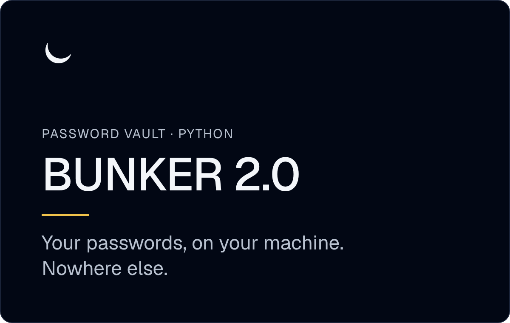
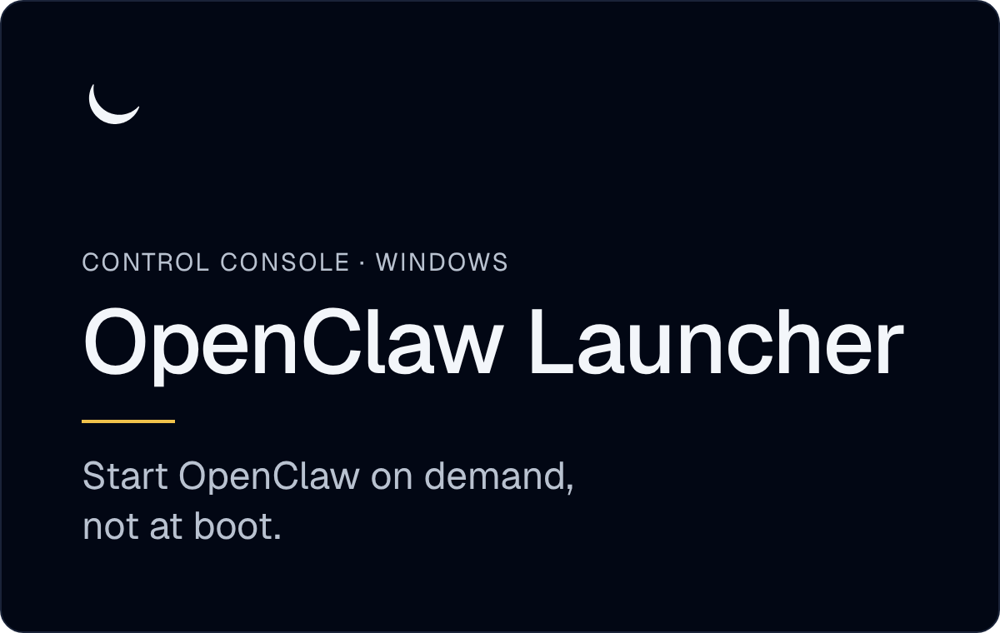

<a href="https://zeromarks.net">
  <picture>
    <source media="(prefers-color-scheme: dark)" srcset="hero-dark.png">
    <source media="(prefers-color-scheme: light)" srcset="hero-light.png">
    
  </picture>
</a>

<h3 align="center">Software that minds its own business.</h3>

  A privacy-first software studio. We make tools that keep your data on your side.
    
  <a href="https://zeromarks.net"><b>zeromarks.net</b></a>
  &nbsp;·&nbsp;
  <a href="https://zeromarks.net/services/">Work with us</a>
  &nbsp;·&nbsp;
  <a href="https://zeromarks.net/security/">Security</a>
  &nbsp;·&nbsp;
  <a href="mailto:hello@zeromarks.net">hello@zeromarks.net</a>

 

  
  

 

**How we build**

- **Your data is not our product.** Nothing we make sells or shares what you put in it.
- **Local when it can be.** BUNKER keeps every password on your machine; no sync server exists to breach.
- **No accounts you don't need.** If a tool works without a sign-up, it ships without one.

**In the studio** — **VinCard**, inventory intelligence for auto dealers. Private while in development · [read more](https://zeromarks.net/vincard/)

Found a security issue? Please don't open a public issue — see <a href="https://zeromarks.net/security/">zeromarks.net/security</a>.
