<a href="https://zeromarks.net">
  <picture>
    <source media="(prefers-color-scheme: light)" srcset="assets/hero-light.svg">
    
  </picture>
</a>

  <a href="https://zeromarks.net"><picture><source media="(prefers-color-scheme: light)" srcset="assets/pill-site-light.svg"></picture></a>
  <a href="https://zeromarks.net/services/"><picture><source media="(prefers-color-scheme: light)" srcset="assets/pill-work-light.svg"></picture></a>
  <a href="https://zeromarks.net/security/"><picture><source media="(prefers-color-scheme: light)" srcset="assets/pill-security-light.svg"></picture></a>
  <a href="mailto:hello@zeromarks.net"><picture><source media="(prefers-color-scheme: light)" srcset="assets/pill-mail-light.svg"></picture></a>

 

 

  <a href="https://github.com/ZeroMarks/BUNKER2.0"><picture><source media="(prefers-color-scheme: light)" srcset="assets/card-bunker-light.svg"></picture></a>
  <a href="https://github.com/ZeroMarks/openclaw-launcher-replacement"><picture><source media="(prefers-color-scheme: light)" srcset="assets/card-openclaw-light.svg"></picture></a>

 

<picture>
  <source media="(prefers-color-scheme: light)" srcset="assets/lunar-light.svg">
  
</picture>

  

  &nbsp;&nbsp;&nbsp;
  &nbsp;&nbsp;&nbsp;
  &nbsp;&nbsp;&nbsp;
  &nbsp;&nbsp;&nbsp;
  &nbsp;&nbsp;&nbsp;
  &nbsp;&nbsp;&nbsp;
  

 

<b>In the studio</b>

 

**VinCard** — inventory intelligence, pricing and lead scoring for auto dealers. Private while in development · [read more](https://zeromarks.net/vincard/)

Found a security issue? Please don't open a public issue — see [zeromarks.net/security](https://zeromarks.net/security/).

 

<picture>
  <source media="(prefers-color-scheme: light)" srcset="assets/footer-light.svg">
  
</picture>
